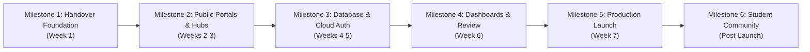

# NACOS UNIUYO Web Portal: Product Requirements Document (PRD)

## 1. Executive Summary & Problem Statement

The Nigeria Association of Computing Students (NACOS), University of Uyo Chapter, maintains a public web presence built on modern web standards (Next.js 16, TypeScript 7).

### The Problem
Presently, all content is hardcoded into the application codebase. Whenever an event date changes, an executive portrait is updated, a department officer is announced, or student projects need showcase:
1. A software developer must manually edit source code files.
2. Changes must go through a code review and a production deployment.
3. If developers are in exams or unavailable, the faculty's official information becomes stale, inaccurate, or delayed.
4. Departments, student innovators, and alumni lack dedicated web real estate to project their identity, achievements, and career opportunities.

### The Solution
We are introducing the **NACOS UNIUYO Web Portal and Faculty Management System**. This platform establishes NACOS UNIUYO as the digital flagship of computing at the University of Uyo. It provides non-technical faculty leaders and department coordinators with self-service administration, creates public showcases for student innovation, establishes department-level hubs, delivers career and opportunity awareness (SIWES/IT, scholarships, partnerships), archives faculty alumni and graduating cohorts, and provides student interaction spaces.

## 2. Strategic Objectives & Success Metrics

1. **Zero-Code Operations:** 100% of executive listings, department directories, project showcases, event schedules, opportunities, yearbook and alumni records, and announcements update through a secure web dashboard.
2. **Institutional Identity & Co-Branding:** Prominently unite NACOS and the University of Uyo (UNIUYO) institutional identity across the entire portal, headers, and social preview cards.
3. **Student Innovation & Project Showcase:** Provide a dedicated gallery displaying embedded systems, cybersecurity tools, software applications, and academic research created by students, departments, and faculty teams.
4. **Autonomous Department Hubs:** Give each of the five departments (Computer Science, Cybersecurity, Information Systems, Data Analytics, Software Engineering) its own dedicated section featuring its executives, staff, alumni, projects, and announcements.
5. **Career & Opportunity Discovery:** Direct channel for students to discover verified SIWES/IT internships, scholarships, sponsorships, and technical partnerships.
6. **Alumni & Cohort Preservation:** Comprehensive archive honoring graduating cohorts and faculty alumni, providing students with professional visibility and preserving institutional memory.
7. **Executive Leadership & Goodwill Voices:** Featured platform for the Dean of the Faculty, staff advisers, alumni, and student leaders to publish welcome notes and goodwill messages.
8. **Student Interaction & Community:** Safe, structured space for computing students across all departments to communicate, collaborate, and share knowledge.

## 3. Scope & Phased Implementation Strategy

Development is structured into disciplined phases to ensure developer ergonomics, independent frontend/backend workflows, and high release velocity.

### Phase 1: Handover Foundation & Tooling (Internal Scaffolding)
- Core framework upgrade: Next.js 16, TypeScript 7, and Bun runtime.
- Automated code hygiene via Lefthook (pre-commit: typecheck + Oxlint; pre-push: build).
- Environment security via T3 Env validating all database, auth, and cloud credentials.
- Shadcn design system foundation with base theme tokens and reusable UI primitives.
- Strongly-typed tRPC router scaffolding with mock seed fixtures, allowing UI engineers to build immediately without requiring live local or remote database instances.
- Pure Bun GitHub Actions workflow for automated Vercel production deployment.

### Phase 2: Public Portals & Department Hubs (Dev Team Stream)
1. **Departmental Hubs (`/departments/[slug]`):**
   - Dedicated spaces for each of the 5 departments: Computer Science, Cybersecurity, Information Systems, Data Analytics, and Software Engineering.
   - Each department hub features its department overview, executive officers, academic and non-teaching staff, featured student projects, alumni spotlight, and department notices.
2. **Student & Faculty Project Showcase (`/projects`):**
   - Searchable, categorized gallery displaying student innovations, department projects, and faculty research.
   - Dedicated categories including Cybersecurity, Embedded Systems, Software Engineering, AI & Data Science, and Academic Research.
   - Project cards and detail pages highlighting team members, department attribution, live demos, code repositories, and screenshots.
3. **Opportunities & SIWES / IT Hub (`/opportunities`):**
   - Curated listings of industrial training (SIWES/IT) placements, corporate internships, scholarships, student sponsorships, technical grants, and faculty industry partnerships.
   - Filterable by department, opportunity type, and application deadline, with verified application links.
4. **Alumni Archive & Living Digital Yearbook (`/yearbook`, `/alumni`):**
   - Annual graduating cohort archives organized by session (e.g. `2024/2025`) and filtered by department.
   - Comprehensive faculty alumni directory connecting past graduates with current undergraduates for mentoring and career networking.
   - Profile pages featuring full name, portrait photo, honours, personal quote/bio, and verified links (LinkedIn, GitHub, Portfolio).
5. **Homepage Leadership & Goodwill Section:**
   - Prominent welcome message immediately beneath the hero banner featuring the Dean of the Faculty of Computing, managed dynamically through platform configuration.
   - Featured carousel or grid displaying verified goodwill messages from faculty patrons, staff advisers, alumni leaders, and council executives.
6. **Event & Programme Hub (`/events`):**
   - Complete event lifecycle (title, description, dates, venue, flyer, timetable/programme) with instant 1-click Google Calendar sync and `.ics` download.
7. **Faculty Newsroom & Blog (`/blog`):**
   - Rich-text editor for official announcements, meeting recaps, press releases, and department newsletters.
8. **Institutional Identity & Co-Branding:**
   - Unified header, footer, and OpenGraph metadata incorporating both NACOS and University of Uyo official insignia.

### Phase 3: Database & Cloud Infrastructure Integration
- Drizzle ORM Neon HTTP setup, schema definitions, relations, and migrations.
- Universal Google OAuth authentication via Better Auth.
- Wire tRPC procedures to live Drizzle queries, deprecating mock seed fallback in production.
- Cloudinary client-side upload signatures and image optimization pipeline for project media and flyers.

### Phase 4: Portals, Dashboards & Moderation Workflows
- **Member Dashboard (`/dashboard`):** Available to all authenticated Google users (`user` role) to manage personal profiles, submit project proposals, submit opportunity listings, and bookmark openings.
- **Department Coordinator Console (`/admin/departments`):** Scoped to assigned departments to manage rosters, post notices, and review student project proposals.
- **Faculty Administrator Control Center (`/admin`):** Global management for Dean's welcome address configuration, goodwill curation, user role assignment, and system settings.

### Phase 5: Student Community & Interaction Space
- Contextual interaction channels on student projects and opportunity postings for peer feedback and mentorship.
- Moderated discussion boards for academic discussions and inter-departmental collaboration.

## 4. User Personas & Permissions

| Role | Who Holds This Role | Capabilities | Safeguards |
| :--- | :--- | :--- | :--- |
| **Public Visitor** | Any prospective student, parent, or external partner | Browse events, sync calendars, read news, view department hubs, explore project showcases, search SIWES/scholarship opportunities, and browse alumni archives. | Read-only. No account needed. |
| **Authenticated User (`user`)** | Any student, staff member, or alumnus signing in via Google | Access member dashboard, manage personal profile, claim alumni yearbook profile, submit project showcase proposals, and submit opportunity listings. | Staged lifecycle (`draft` -> `submitted` -> `approved` / `rejected`). |
| **Department Coordinator (`department_editor`)** | Departmental PROs, Secretaries, Project Committee, Media Team | Manage departmental officer listings, staff directories, and notices; review and approve student project submissions within their assigned department. | Actions strictly scoped to their assigned department ID. |
| **Faculty Administrator (`admin`)** | President, Staff Adviser, Director of Software, Dev Team Lead | Full platform control; update Dean's welcome address configuration; curate and reorder goodwill messages; assign user roles; global publish authority. | Session verification and audit trails on all administrative actions. |

## 5. Governance & Operational Continuity

### A. Editorial Accountability
All published articles, events, project showcases, opportunity listings, and alumni cohorts permanently record the author identity and timestamp. If an editor leaves the faculty executive council, their previously verified content remains intact with proper attribution, while their portal permissions are revoked immediately across all active sessions.

### B. Link Reliability & Social Sharing Safety
When an editor updates a post, project showcase, event title, or yearbook profile, the public URL slug remains stable. If a slug is explicitly changed, the system preserves automated redirects so that links previously broadcast to WhatsApp groups or student forums never yield a 404 dead page.

### C. Project & Opportunity Moderation Workflow
All student project submissions and opportunity listings must pass an explicit review pipeline (`draft` -> `submitted` -> `approved` or `rejected` with reason) before going live to preserve institutional credibility and protect students from unvetted or predatory postings.

## 6. Implementation Timeline & Milestones

| Milestone | Deliverable | Acceptance Criteria |
| :--- | :--- | :--- |
| **Milestone 1: Handover Foundation** | Tooling (Next.js 16, TypeScript 7, Oxlint, Lefthook, T3 Env, Bun), shadcn primitives, and mock tRPC routers. | Clean local typechecking, linting, build, and offline mock-data dev experience. |
| **Milestone 2: Public Portals & Hubs** | Department hubs for all 5 departments, project showcase, SIWES directory, alumni/yearbook archives, and UNIUYO co-branding. | Public routes render with rich mock data; students can browse and filter projects and opportunities. |
| **Milestone 3: Database & Cloud Auth** | Neon serverless database, Drizzle ORM schemas, Better Auth with Google OAuth, and Cloudinary uploads. | Users can sign in with Google; tRPC procedures persist and fetch live records from Neon. |
| **Milestone 4: Dashboards & Review** | User dashboard, department editor consoles, Dean's address config, and project/opportunity review queues. | Non-technical coordinators review and approve student projects; admins update Dean's address without code deploys. |
| **Milestone 5: Production Rollout & Training** | Faculty executive rollout and training. | The PRO, General Secretary, and departmental executives manage content without developer intervention. |
| **Milestone 6: Student Community Platform** | Student interaction and discussion platform. | Students can safely interact on projects and opportunities with active moderation controls in place. |

## 7. Acceptance Criteria for Final Sign-Off

The project is officially accepted and certified ready for production when:
1. **Zero-Deploy Verification:** A non-technical executive successfully creates an event, publishes a student project, updates an opportunity listing, and edits an officer profile without developer intervention or terminal access.
2. **University Co-Branding:** The University of Uyo official insignia and NACOS identity are prominently positioned across the portal, communicating institutional affiliation.
3. **Dean's Address & Goodwill Visibility:** The Dean's welcome message appears in its designated homepage section immediately following the hero via platform configuration, and goodwill messages from staff, alumni, and executives can be curated dynamically.
4. **Department Hub Autonomy:** All five computing departments have distinct, accessible URLs showing their excos, staff, alumni, and departmental projects.
5. **Project & Opportunity Workflows:** Authenticated users can submit project proposals and opportunities; coordinators can approve or reject them with feedback; visitors can filter projects and opportunities cleanly.
6. **Alumni & Living Yearbook:** Graduating sets are indexed by academic session and department, showcasing graduate achievements and verified professional contacts with alumni profile claim capabilities.
7. **Google Authentication & Role Segregation:** Anyone can sign in with a Google account to access member features; role permissions enforce department-level and global admin boundaries securely.
8. **Social Share Previews:** Sharing any published project, department page, opportunity, or event link on WhatsApp displays an attractive preview card with the custom flyer/cover and title.

## 8. Companion Technical Specification

<page url="https://app.notion.com/p/418c845593118198aaf8d5bab945a6cc">NACOS UNIUYO Portal: Technical Architecture Specification (RFC)</page>
